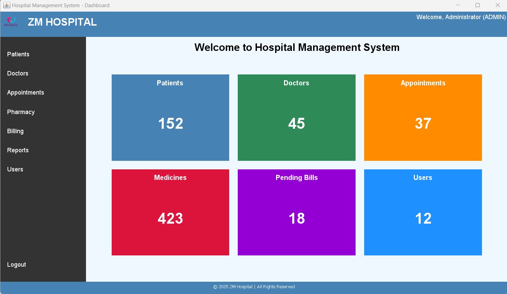
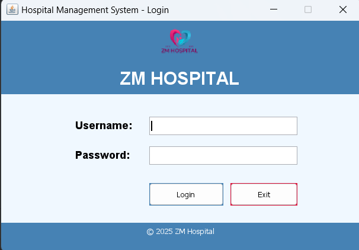
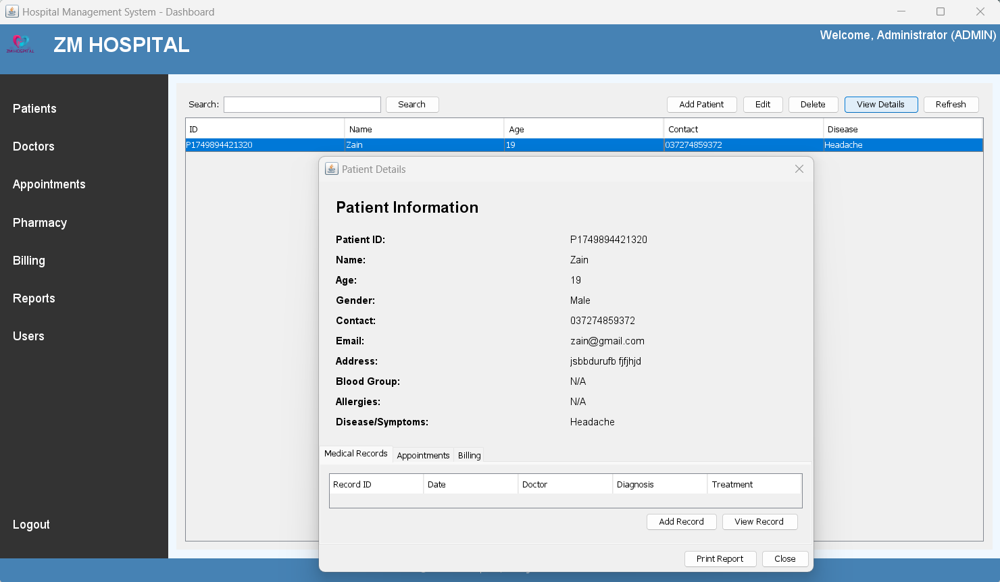
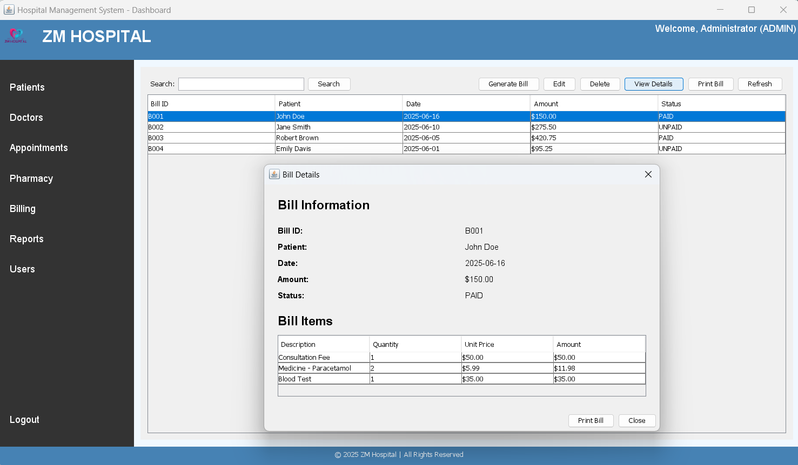
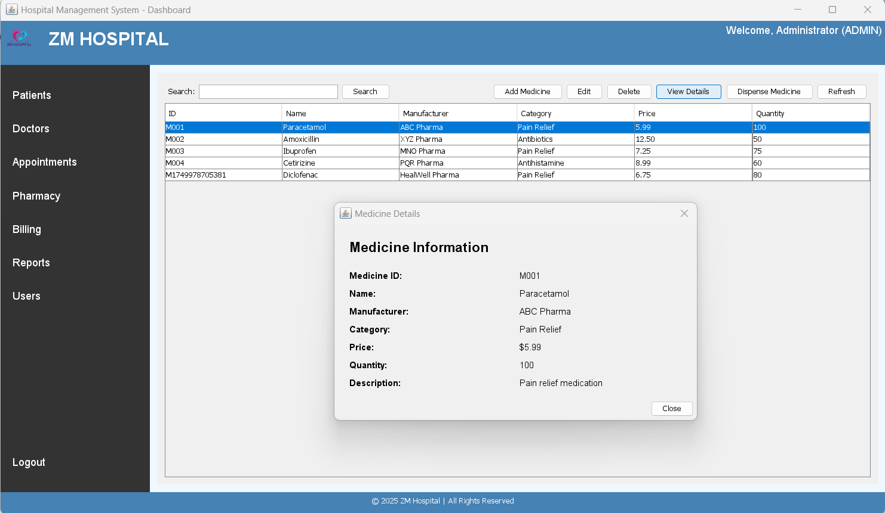
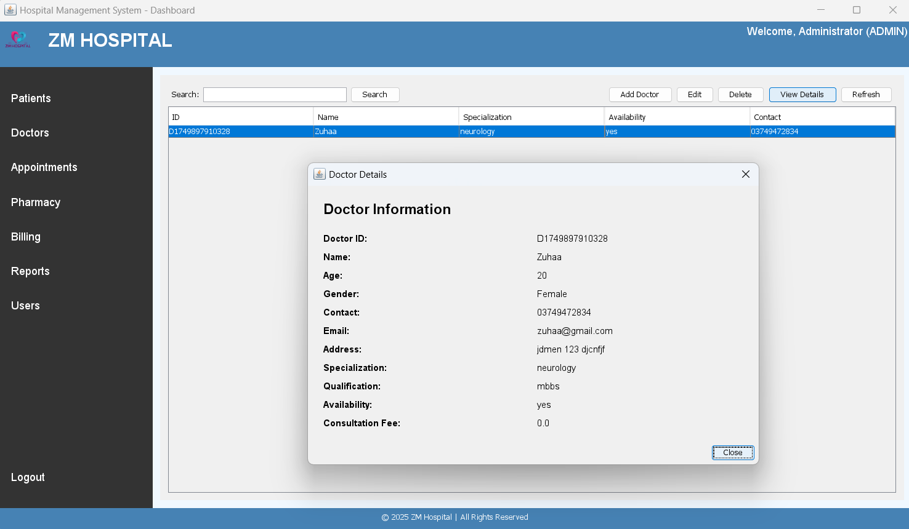
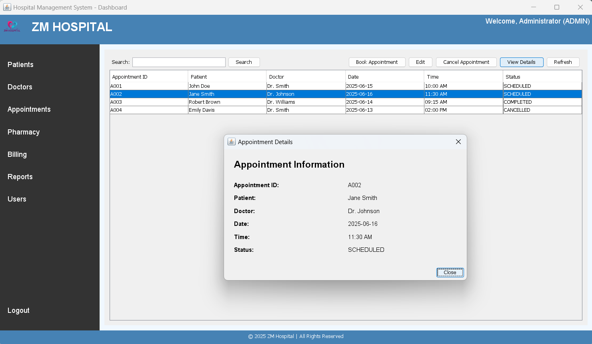
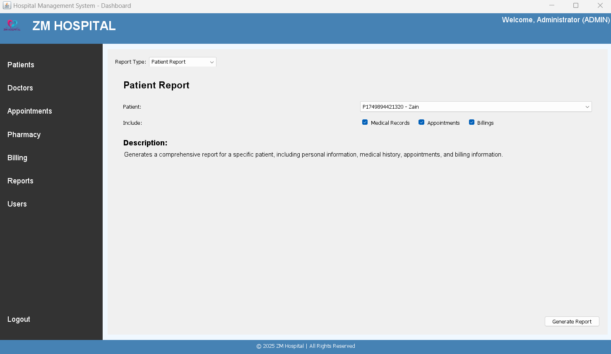
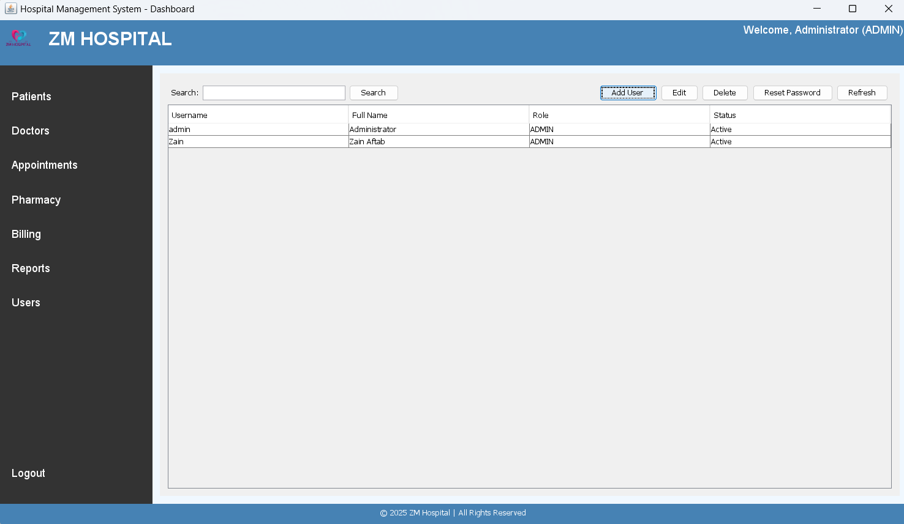

<div align="center">


# 🏥 ZM Hospital Management System (Java Swing)

A desktop hospital management system built with Java Swing and object-oriented design. It covers patients, doctors, appointments, pharmacy, billing with PDF invoices, reports and user accounts, with all data stored in plain text files.




</div>

> Looking for the web version? See [Hospital-Management-System-React](https://github.com/ZainAftab-dev/Hospital-Management-System-React) (Next.js + NestJS + SQL Server).

---

## Features

| Module | What you can do |
|---|---|
| **Login and users** | Sign in with a username and password (stored as SHA-256 hashes); admins add, edit and delete user accounts with roles such as Admin, Doctor, Nurse and Receptionist |
| **Patients** | Register, edit, delete and search patients; view full details with medical records, appointments and billing tabs; print a patient report as PDF |
| **Doctors** | Manage doctor profiles, specialisations, consultation fees and available time slots |
| **Appointments** | Book, edit and cancel appointments between patients and doctors and track their status |
| **Pharmacy** | Keep the medicine inventory (manufacturer, category, price, quantity) and dispense medicines to patients |
| **Billing** | Build bills from multiple line items (consultation, medicines, tests), apply discount and tax, mark them paid or unpaid, and print a PDF invoice |
| **Reports** | Generate patient and billing reports as PDF files |
| **Dashboard** | Summary tiles for patients, doctors, appointments, medicines, pending bills and users |

## Screenshots

| Login | Patient details | Billing |
|---|---|---|
|  |  |  |

| Pharmacy | Dispensing medicine | Generated invoice (PDF) |
|---|---|---|
|  |  |  |

| Doctors | Appointments | Reports | Users |
|---|---|---|---|
|  |  |  |  |

## Architecture

The code is split into layers, each behind an interface:

```
UI (Swing frames and panels)
        │
Service layer      PatientService, DoctorService, MedicineService, UserService   implements ManagementService<T, ID>
        │
DAO layer          PatientDAO, DoctorDAO, MedicineDAO, UserDAO (extend FileBasedDAO)   implements DataAccessObject<T, ID>
        │
Storage            data/*.txt    and    reports/*.pdf (via PDFGenerator)
```

OOP concepts used:
- **Abstraction and inheritance:** abstract `Person` class extended by `Patient`, `Doctor` and `Nurse`
- **Interfaces and generics:** `DataAccessObject<T, ID>`, `ManagementService<T, ID>`, `ReportGenerator<T>`
- **Encapsulation:** private fields with validated setters (for example, medicine quantity can never be negative)
- **Custom exceptions:** `AuthenticationException`, `ValidationException`, `DataAccessException`

## Project structure

```
hospital-management-system/
├── src/hms/
│   ├── Main.java              # entry point: creates data folders, opens the login window
│   ├── model/                 # Person, Patient, Doctor, Nurse, User, Appointment, Billing, Medicine, MedicalRecord, Prescription
│   ├── interfaces/            # DataAccessObject, ManagementService, ReportGenerator
│   ├── dao/                   # FileBasedDAO + one DAO per entity
│   ├── service/               # business logic
│   ├── exception/             # custom exceptions
│   ├── ui/                    # LoginFrame, DashboardFrame and one panel per module
│   └── util/                  # PDFGenerator (iText), PasswordUtils (SHA-256), ValidationUtils
├── data/                      # users.txt, patients.txt, doctors.txt, medicines.txt
├── reports/                   # generated PDF bills and reports
├── Screenshots/
└── logo.png
```

## Getting started

**Requirements**
- JDK 8 or newer
- iText 5 PDF library: [itextpdf-5.5.13.3.jar](https://repo1.maven.org/maven2/com/itextpdf/itextpdf/5.5.13.3/itextpdf-5.5.13.3.jar) (used for bills and reports)

**IntelliJ IDEA (easiest)**
1. File → Open → select the project folder. The iText library is already configured in `.idea/libraries`, so IntelliJ downloads it from Maven automatically.
2. Run `src/hms/Main.java`.

**Command line**

```bash
git clone https://github.com/ZainAftab-dev/hospital-management-system.git
cd hospital-management-system

# put the iText jar in a lib folder
mkdir lib
curl -L -o lib/itextpdf-5.5.13.3.jar https://repo1.maven.org/maven2/com/itextpdf/itextpdf/5.5.13.3/itextpdf-5.5.13.3.jar

# compile and run (on Windows replace ':' with ';' in the classpath)
javac -d out -cp "lib/*" $(find src -name "*.java")
java -cp "out:lib/*" hms.Main
```

Run the program from the project folder so it can find `data/` and `logo.png`.

**Default login**

| Username | Password | Role |
|---|---|---|
| `admin` | `admin` | Administrator |

Change this password after the first login.

## Known limitations

- Text-file storage, so it is meant for a single user on one machine
- The dashboard tiles show sample figures, not live counts
- Appointments and bills start from sample data and are not yet saved to `data/` between runs
- No automatic backup of the `data/` folder

## Team

Object-Oriented Programming project, BS Software Engineering, COMSATS University Islamabad (Lahore Campus).

| Name | Registration No. |
|---|---|
| Zain Aftab | FA24-BSE-155 |
| Musfirah Qadeer | FA24-BSE-101 |
| Zuhaa Wasim | FA24-BSE-119 |

Maintained by **Zain Aftab** · [GitHub](https://github.com/ZainAftab-dev) · [zainaftab589@gmail.com](mailto:zainaftab589@gmail.com)

## License

[MIT](LICENSE)
